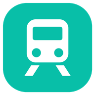
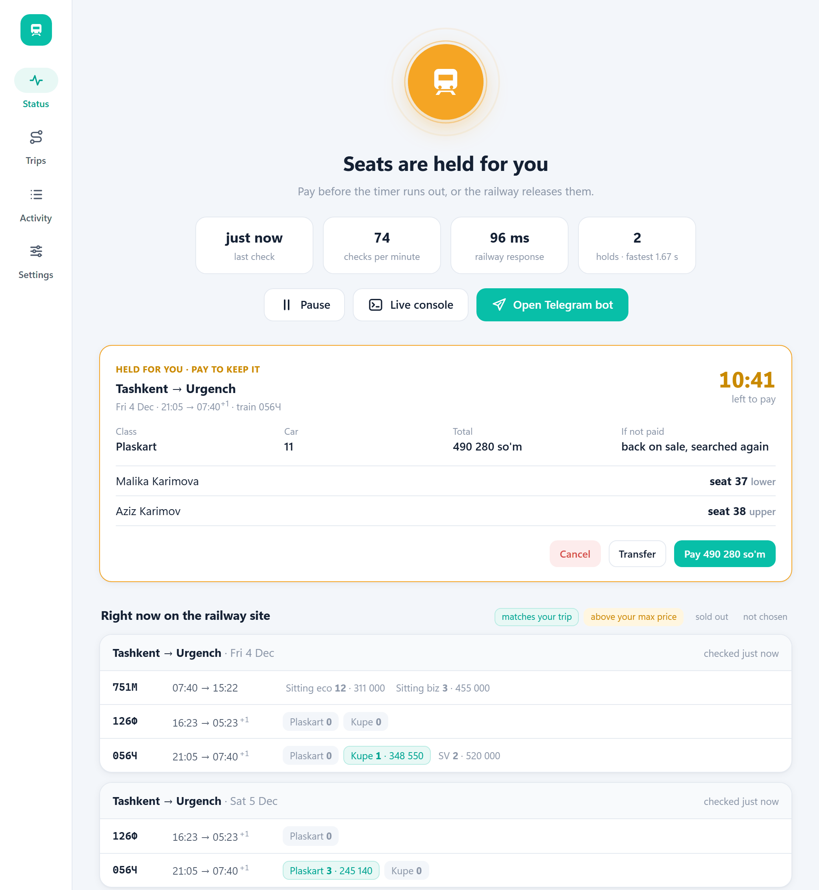
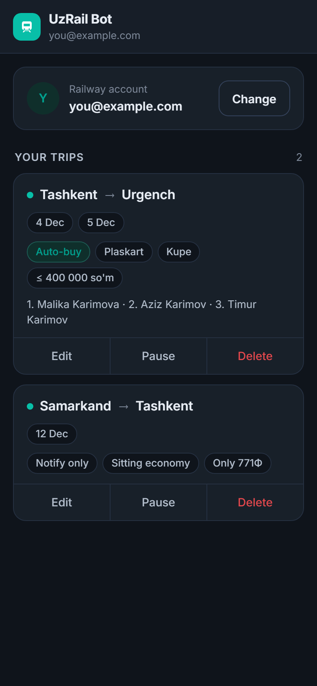
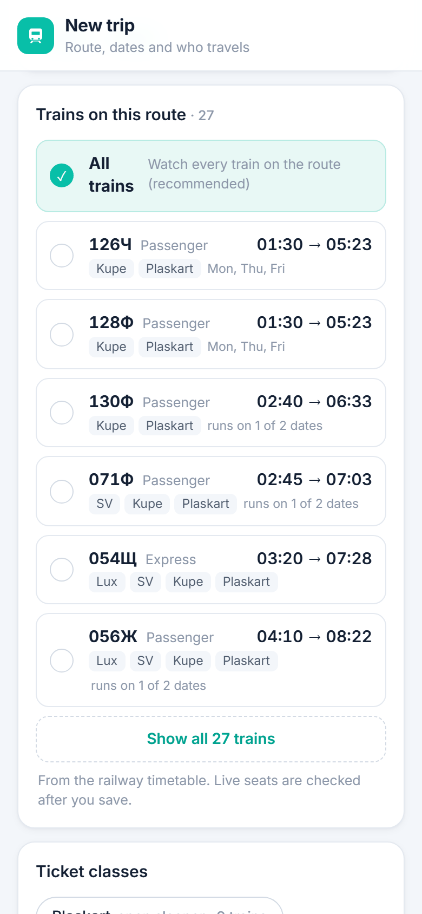
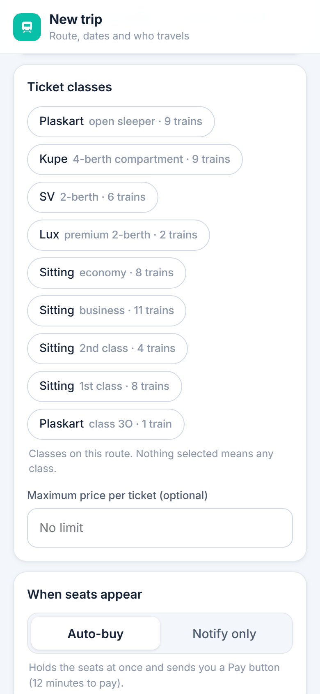
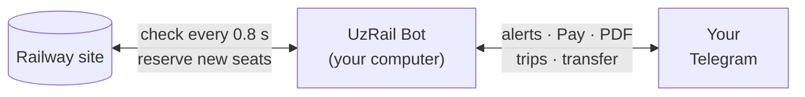
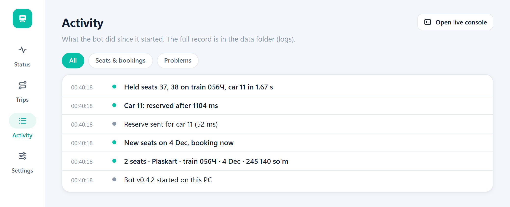

<div align="center">



# UzRail Ticket Bot

**Catch sold-out Uzbekistan Railways tickets the moment a seat frees up.**<br>
Runs on your own computer, controlled from your own Telegram bot. Free and open source.

[](https://github.com/myrosama/uzrail-ticket-bot/actions/workflows/installers.yml)
[](https://github.com/myrosama/uzrail-ticket-bot/tags)

[](LICENSE)

[Install](#install) · [Setup](#setup-in-2-minutes) · [How it works](#how-it-works) · [FAQ](#faq)



</div>

> [!NOTE]
> **Unofficial.** It sends the same requests as the eticket.uzrailpass.uz website, using your own account.
> Automated booking may be against the site's terms; use it at your own risk. It never pays by itself: you
> always confirm the payment on the bank's page.

## Why

On popular routes (Tashkent ⇄ Urgench, Samarkand, Bukhara, Khiva…) tickets sell out early. Seats come back at
random moments: someone cancels, or a 12-minute reservation runs out unpaid. Whoever clicks first gets them.

UzRail Bot checks the railway site about every second and reserves the seat for you within about two seconds.
Then it sends you a **Pay** button in Telegram.

## Highlights

- ⚡ **Fast**: usually about 2 s from a seat appearing to it being held in your name (measured on real
  sold-out trains).
- 🚆 **Every route and class**: plaskart, kupe, SV, lux and sitting. Pick a route and you see its trains, times
  and classes.
- 👥 **Up to 4 passengers** in priority order: if fewer seats appear, the first passengers get them.
- 💳 **You pay, it books**: pay on Hamkorbank's own page; the ticket PDF arrives in the chat.
- 🔄 **Transfer**: give a held seat to another of your saved passengers in a couple of seconds.
- 📊 **See everything**: per-passenger status in Telegram, a live board of free seats, an activity feed and a
  live console.
- 🔒 **Private**: runs on your computer. Your railway password is encrypted on your phone before it leaves it.
- ⬆️ **Updates itself**: new versions install in the background, never in the middle of a booking.

## Install

One line. It gets Python if needed, installs the app, adds it to your apps and opens it.

**Windows**: open PowerShell and paste:

```powershell
irm https://raw.githubusercontent.com/myrosama/uzrail-ticket-bot/main/install.ps1 | iex
```

**macOS and Linux**: open Terminal and paste:

```bash
curl -fsSL https://raw.githubusercontent.com/myrosama/uzrail-ticket-bot/main/install.sh | bash
```

| | Where it appears |
| --- | --- |
| Windows | Start menu and desktop: **UzRail Bot**, with a tray icon |
| macOS | **Applications → UzRail Bot**, with a menu-bar icon |
| Linux | The app menu, with a tray icon |
| Linux server, no screen | `… \| bash -s -- --headless` sets up in the terminal and runs as a systemd service |

Every change to the installers is tested on real Windows, macOS and Ubuntu machines: install, start the app,
talk to it, quit, uninstall.

## Setup in 2 minutes

1. **Create a Telegram bot.** Open [@BotFather](https://t.me/BotFather), send `/newbot` and copy the token.
2. **Paste the token** into the UzRail Bot window. Then open your new bot on your phone and press **Start**.
   The window shows your name; confirm it. Only your Telegram account can control the bot.
3. **In Telegram, tap 🚆 Trips & settings.** A small app opens inside Telegram:
   - connect your eticket.uzrailpass.uz login;
   - add a trip: route, dates, the trains and classes you accept, a maximum price and up to 4 passengers in
     priority order (from your saved passengers on the railway site);
   - choose **Auto-buy** or **Notify only**.
4. **Leave the computer on.** On Windows and macOS the bot keeps it from sleeping while it watches.

<p align="center">
  
  &nbsp;
  
  &nbsp;
  
</p>

As soon as you pick From and To, the editor lists that route's trains:
- departure → arrival times;
- the classes each train carries;
- whether it runs on your dates.

Every train is watched by default; tap one to watch only that train. **Ticket classes** then shows just the
classes those trains have.

## What you get in Telegram

1. **🎫 Tickets appeared**: train, class, free seats and price.
2. **✅ Seats reserved**: car, seat and berth for each passenger. If someone was faster, you get
   **❌ Not this time** and the bot keeps watching.
3. **💳 Pay**, with a countdown (the railway holds seats for about 12 minutes). After you pay, the bot sends the
   **ticket PDF**.

If you don't pay in time, the seats go back on sale. Those passengers go back on the search list, and the bot
catches the seat again if it reappears.

**🔄 Transfer to another passenger** gives a held seat to anyone among your saved passengers, whether lower in
the trip or not on it at all. The bot cancels the reservation and re-books the same seat for them at once.
Everyone else sees a freed seat only 2–9 s later. On the live site the seat was held again about 2 s after
the release.

**📊 Status** lists every passenger:
- held: where, when, and how long is left to pay;
- searching;
- ticket bought.

It also shows what the railway has right now on your dates.

## How it works



There is no browser automation. The bot talks to the railway's own API, the same one the website uses.

- **Booking:** the moment a seat shows up, it sends one reservation to the train's most likely car on an
  already-open connection, and tries the train's other cars in parallel.
- **Confirmation:** the railway confirms over its live channel.
- **Duplicates:** the bot keeps the first hold and releases any extras.

| Step | Time |
| --- | --- |
| Noticing a new seat | up to ~0.8 s (the check interval) |
| Sending the reservation | under 0.1 s |
| The railway confirming the hold | 1–2 s |
| **Real catches, seat visible → held** | **1.1–3.3 s, usually about 2 s** |

The bot stays far below the site's rate limits and backs off if asked to slow down. The research behind all
of this, with measurements, is in [docs/RESEARCH.md](docs/RESEARCH.md).

## The desktop app

The window shows:
- **Status:** what's happening, held seats with Pay / Transfer / Cancel, and a live board of free seats per
  train;
- **Trips:** each passenger: searching, seat held or ticket bought;
- **Activity:** with filters;
- **Settings.**

On Windows and Linux the tray icon is green while watching, amber when seats are held, grey when paused and red
on a problem. On a Mac the menu-bar icon keeps one colour. Closing the window keeps the bot running.

**Live console** opens a terminal window that shows everything as it happens: every check, every request,
every booking step.

<p align="center"></p>

<details>
<summary><b>Command line</b></summary>

`uzrailbot` on macOS and Linux; on Windows `%LOCALAPPDATA%\UzRailBot\venv\Scripts\python -m uzrailbot`.

| Command | |
| --- | --- |
| `uzrailbot` | The desktop app |
| `uzrailbot run` | No window: console mode for servers |
| `uzrailbot setup` | Link a different Telegram bot (in the terminal) |
| `uzrailbot report [N]` | Timeline of the latest session: every check, detection and booking step with timings |
| `uzrailbot live` | Live console (`--all` replays the whole session) |
| `uzrailbot autostart on\|off` | Start with the computer |
| `uzrailbot where` | Where settings and logs are kept |

In Telegram: `/status`, `/passengers` (reload saved passengers), `/pause`, `/resume`, `/account`.

</details>

## FAQ

<details>
<summary><b>Does it pay for me?</b></summary>

No. It reserves the seat and sends you a Pay button. You enter your card on Hamkorbank's own page.
</details>

<details>
<summary><b>What if I don't pay within 12 minutes?</b></summary>

The railway releases the seat. Those passengers go straight back on the search list, so the bot catches the
seat again if it reappears, or another one.
</details>

<details>
<summary><b>Does my computer have to stay on?</b></summary>

Yes. The bot can only watch while it runs. It keeps Windows and macOS awake while trips are active. For
24/7 watching you can also run it on a small Linux server (`--headless`).
</details>

<details>
<summary><b>Can this get my railway account blocked?</b></summary>

It is unofficial, so there's no guarantee. It behaves gently: about one check every 0.8 s per route and date,
far below the site's limits, and it backs off when the site asks. Use it at your own risk.
</details>

<details>
<summary><b>Is my password safe?</b></summary>

The Telegram mini app encrypts your railway password on your phone with your computer's public key, so
Telegram only ever carries ciphertext. On your computer it is stored encrypted: DPAPI on Windows, a private
key file on macOS and Linux. Nothing is sent anywhere else.
</details>

<details>
<summary><b>Which trains and routes are covered?</b></summary>

All of them. The mini app's timetable lists 84 trains with their stops, times, running days and classes, so
any From/To pair along a route works. The bot itself always checks the railway's live train list, so it
also sees trains the timetable doesn't have.
</details>

<details>
<summary><b>How do I update or uninstall?</b></summary>

Updates are automatic: on start and every 6 hours, never during a booking. Settings → **Check now** forces
it.

To uninstall:
- **Windows:** `& ([scriptblock]::Create((irm https://raw.githubusercontent.com/myrosama/uzrail-ticket-bot/main/install.ps1))) -Uninstall`
- **macOS / Linux:** `curl -fsSL https://raw.githubusercontent.com/myrosama/uzrail-ticket-bot/main/install.sh | bash -s -- --uninstall`

Your settings folder is kept; delete it to remove everything.
</details>

<details>
<summary><b>Something went wrong. Where are the logs?</b></summary>

- **Settings → Data folder** opens the logs folder. `logs/sessions/` has a full recording of every run, and
  it never contains passport numbers.
- `uzrailbot report` prints the latest session as a timeline.
- The **Live console** shows what's happening right now.
</details>

## Privacy

Everything stays on your computer:
- Windows: `%LOCALAPPDATA%\UzRailBot`
- macOS: `~/Library/Application Support/UzRailBot`
- Linux: `~/.local/share/UzRailBot`

The Telegram mini app is a static page (`docs/`, on GitHub Pages) with no server behind it. The desktop window
talks to the bot only over `127.0.0.1`, with a random key per run.

<details>
<summary><b>Development</b></summary>

```bash
python -m venv .venv && .venv/bin/pip install -e .     # Windows: start.bat
python -m uzrailbot                                    # UZRAILBOT_HOME=<dir> keeps test data separate
python tools/build_stations.py                         # refresh docs/stations.json (stations for the mini app)
python tools/build_timetable.py                        # refresh docs/timetable.json (~20 min; --resume)
python tools/make_icons.py                             # regenerate the icons
```

| Path | |
| --- | --- |
| `uzrailbot/engine.py` | Watch, book, hold, transfer |
| `uzrailbot/eticket.py` | The railway API client |
| `uzrailbot/telegram.py` | The Telegram bot |
| `uzrailbot/gui.py`, `uzrailbot/ui/` | The desktop window and tray |
| `uzrailbot/updater.py` | Self-update from this repository |
| `docs/` | The Telegram mini app, served by GitHub Pages |
| `.github/workflows/installers.yml` | Installer tests on Windows, macOS and Ubuntu |

To ship an update to every installed copy, raise `__version__` in `uzrailbot/__init__.py` and push to `main`.
Pushes without a version change don't trigger updates. The mini app updates for everyone as soon as GitHub
Pages publishes it.

</details>

## License

[MIT](LICENSE). Not affiliated with Uzbekistan Railways (O'zbekiston temir yo'llari) or Hamkorbank.
